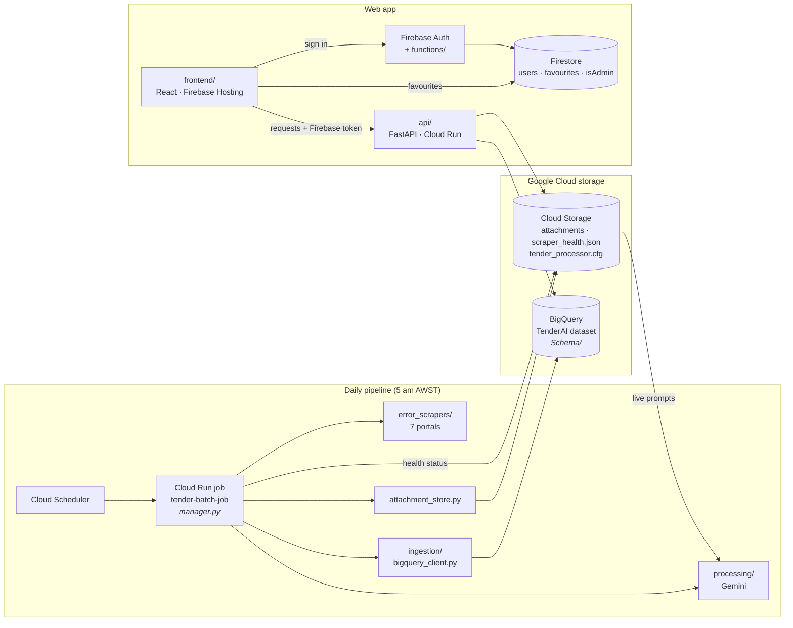
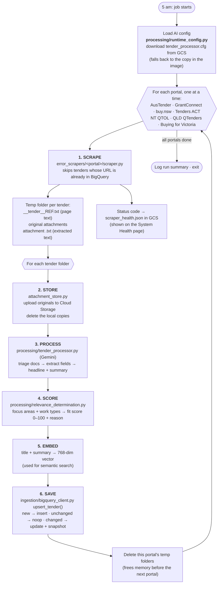
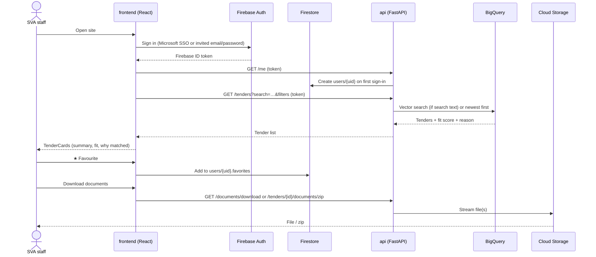
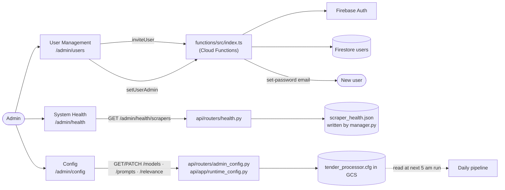
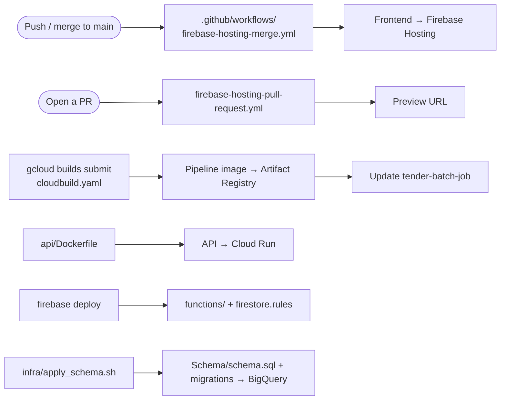

# TenderAI: Automated Tender Discovery and Opportunity Matching

## Group number 57

## Team members

| NAME                     | StudentID   |   GitHubID     |
|--------------------------|-------------|----------------|
| Utkrista Sen             | 24145884    | UtkristaUwa    |
| Sepehr Moghani Pilehroud | 23642415    | sepehrmoghani  |
| Jinghao Hu | 24183532 | jinghao163 |
| Lucan McDonald | 24214099 | PiesOnTues |
| Benjamin Gilmore | 23706738 | bgilmore22 |
| Radrados                 | Radrados         | 23423175    |


# TenderAI

An automated opportunity-discovery and matching system built for Social Ventures Australia (SVA).

## Overview

SVA works with government, philanthropy, businesses and for-purpose organisations across 
consulting, social impact investing and sector development. Relevant tenders, RFQs, grants 
and partnership opportunities are scattered across many government and institutional sources, 
and are easily missed since staff can't monitor every source continuously.

TenderAI will:
- Monitor a configurable set of procurement and funding sources
- Identify new opportunities and extract key information
- Remove duplicates
- Assess relevance against SVA's organisational interest profiles (e.g. evaluation, strategy, 
  employment, early childhood, housing, First Nations economic participation, social impact 
  investing, responsible AI)
- Write relevant opportunities to a central database/spreadsheet
- Notify staff via Microsoft Teams (or similar)
- Let users see why an opportunity was matched, review source docs, and accept/reject with feedback
- Provide an admin interface to manage sources, profiles, keywords, thresholds and system status


# How TenderAI Works

TenderAI is built from three flows that share one BigQuery database and one Cloud Storage bucket:

1. **The daily pipeline** finds new tenders, reads them with AI and saves them.
2. **The user flow** lets SVA staff sign in, search, filter, favourite and download tenders.
3. **The admin flow** lets admins manage users, check scraper health and tune the AI.

> The diagrams use Mermaid, which GitHub renders automatically.

```CITS3200_57/
├── .github/
│   └── workflows/
│       ├── deploy-backend.yml
│       └── deploy-frontend.yml
├── api/
│   ├── app/
│   │   ├── __init__.py
│   │   ├── auth.py
│   │   ├── config.py
│   │   ├── main.py
│   │   ├── query_parser.py
│   │   ├── routers/
│   │   │   ├── __init__.py
│   │   │   ├── admin.py
│   │   │   ├── locations.py
│   │   │   └── tenders.py
│   │   ├── schemas.py
│   │   ├── services/
│   │   │   ├── __init__.py
│   │   │   ├── bigquery_service.py
│   │   │   ├── classification_service.py
│   │   │   ├── embedding_service.py
│   │   │   ├── firestore_service.py
│   │   │   ├── gemini_service.py
│   │   │   └── scraper_service.py
│   │   └── utils.py
│   ├── Dockerfile
│   ├── requirements.txt
│   └── tests/
│       ├── __init__.py
│       ├── test_admin.py
│       ├── test_auth.py
│       ├── test_locations.py
│       ├── test_main.py
│       ├── test_query_parser.py
│       ├── test_schemas.py
│       └── test_tenders.py
├── frontend/
│   ├── .env
│   ├── .env.production
│   ├── .gitignore
│   ├── README.md
│   ├── eslint.config.js
│   ├── firebase.json
│   ├── index.html
│   ├── package-lock.json
│   ├── package.json
│   ├── public/
│   │   └── sva-logo.png
│   ├── src/
│   │   ├── App.tsx
│   │   ├── assets/
│   │   │   └── sva-logo.png
│   │   ├── components/
│   │   │   ├── AdminConfigPage.tsx
│   │   │   ├── AdminRoute.tsx
│   │   │   ├── ForgotPasswordPage.tsx
│   │   │   ├── LoginPage.tsx
│   │   │   ├── ManageUsersPage.tsx
│   │   │   ├── NavBar.tsx
│   │   │   ├── RegisterPage.tsx
│   │   │   ├── TenderDetailPage.tsx
│   │   │   ├── TenderFilterBar.tsx
│   │   │   ├── TenderListPage.tsx
│   │   │   └── TenderTable.tsx
│   │   ├── contexts/
│   │   │   └── AuthContext.tsx
│   │   ├── firebaseConfig.ts
│   │   ├── hooks/
│   │   │   └── useTenderFilters.ts
│   │   ├── main.tsx
│   │   ├── services/
│   │   │   └── api.ts
│   │   ├── theme.ts
│   │   └── vite-env.d.ts
│   ├── tsconfig.app.json
│   ├── tsconfig.json
│   ├── tsconfig.node.json
│   └── vite.config.ts
├── scrapers/
│   ├── Dockerfile
│   ├── main.py
│   ├── requirements.txt
│   ├── run_scraper.sh
│   └── spiders/
│       ├── __init__.py
│       ├── austender_spider.py
│       ├── base_spider.py
│       ├── buysa_spider.py
│       ├── eprocure_spider.py
│       ├── gem_spider.py
│       ├── nsw_spider.py
│       ├── qld_spider.py
│       ├── tenders_vic_spider.py
│       └── wa_spider.py
├── .gitignore
├── LICENSE
└── README.md
```

## The big picture



---

## 1. Daily pipeline: `manager.py`

Cloud Scheduler starts the Cloud Run job `tender-batch-job` at 5 am Perth time. The job runs the `Dockerfile` image, and that image runs `manager.py`. Cloud Build (`cloudbuild.yaml`) rebuilds the image when code changes.



### Step by step

| # | Stage | Code | Reads | Writes |
|---|---|---|---|---|
| 0 | Load config | `processing/runtime_config.py` | `tender_processor.cfg` in GCS | Local copy for this run |
| 1 | Scrape | `error_scrapers/<portal>/scraper.py` + `common.py` | Portal websites, known URLs from BigQuery | Temp folder per tender, status code |
| 1b | Health | `manager.py` → `publish_health_status_to_gcs` | Status codes | `scraper_health.json` in GCS |
| 2 | Store attachments | `attachment_store.py` | Temp attachments | GCS bucket, plus document records |
| 3 | AI processing | `processing/tender_processor.py` | `.txt` files in the tender folder | Structured tender record |
| 4 | Relevance | `processing/relevance_determination.py` | Tender record | `focus_areas`, `work_types`, `fit`, `fit_reason` |
| 5 | Embedding | `manager.py` → `generate_embedding` | Title + summary | `embedding` vector |
| 6 | Save | `ingestion/bigquery_client.py` | Final record | `tenders` + `tender_snapshots` tables |

**Points worth knowing**
- Portals run **one at a time**, and each portal's files are deleted before the next starts, so memory use stays low. Tenders from portals that already finished are saved even if a later portal crashes.
- If a scraper fails, the run still continues. The failure shows up on the System Health page, and the job exits with an error code.
- If relevance scoring fails, the tender is **still saved**, with empty fit fields. If AI processing fails, that tender is skipped.
- Running `python manager.py --local` only scrapes 2 tenders per site into a local folder. It does no AI processing and touches no cloud services.

---

## 2. User flow: finding a tender



| What the user does | Frontend | API / backend |
|---|---|---|
| Sign in | `LoginPage`, `lib/AuthContext.tsx`, `lib/firebase.ts` | Firebase Auth; `api/app/auth.py` checks the token |
| Browse / search / filter | `TendersPage`, `TenderFilterBar`, `lib/useTenderFilters.ts` | `GET /tenders`, `GET /locations` → `api/app/bigquery.py` |
| See why it matched | `TenderCard` | `fit`, `fit_reason`, `focus_areas`, `work_types` columns |
| Favourite | `FavoritesPage`, `lib/FavoritesContext.tsx` | Firestore `users/{uid}` (protected by `firestore.rules`) |
| Share | `ShareTenderDialog`, `lib/tenderShare.ts` | none (link only) |
| Download docs | `TenderDocuments` | `GET /documents/download`, `GET /tenders/{id}/documents/zip` (`document_zip.py`) |

---

## 3. Admin flow

Pages under `/admin` (`AdminLayout`) are only shown to users whose `users/{uid}.isAdmin` is `true`.



**How the AI config loop works.** An admin edits prompts, models or scoring weights on the Config page. The API saves those changes to `tender_processor.cfg` in Cloud Storage. The next daily run downloads that file, so the changes apply from the next morning. `infra/sync_runtime_config.sh pull|push|diff` keeps the git copy (`processing/tender_processor.cfg`) in step with the live one. If the pipeline can't read the live config, it uses the copy in its image, and `infra/alert_runtime_config_fallback.yaml` raises an alert.

---

## 4. Deploying and supporting code



| Folder | Role in the flow |
|---|---|
| `infra/` | One-off and maintenance scripts: GCP setup, schema apply, config sync, alerting |
| `Schema/` | Defines the BigQuery tables everything reads from and writes to |
| `tests/` | `pytest` for the pipeline and API (offline fixtures; `--live` hits real portals); Node tests for Firestore rules and Functions |
| `documentation/` | Owner manual, SSO setup, full docs |
| `web_scrapers/` | Old scrapers, **not in the flow**, kept for reference |

---

## Data at a glance

| Where | What lives there | Written by | Read by |
|---|---|---|---|
| BigQuery `tenders` | One row per tender (fields, summary, fit, embedding, document links) | `ingestion/bigquery_client.py` | `api/`, `manager.py` (dedupe) |
| BigQuery `tender_snapshots` | History of each change to a tender | `ingestion/bigquery_client.py` | Audit / history |
| Cloud Storage `tenderai-dev-documents` | Original attachments, `scraper_health.json`, crawl cursors | `attachment_store.py`, `manager.py`, `error_scrapers/crawl_state.py` | `api/` (downloads, health) |
| Cloud Storage `tenderai-dev-runtime-config` | Live `tender_processor.cfg` | Admin Config page via `api/` | `processing/runtime_config.py` |
| Firestore `users/{uid}` | Profile, favourites, `isAdmin` | `api/app/auth.py`, frontend, `functions/` | Frontend, `functions/` |
| Secret Manager | Tender portal logins | Set by hand | `tender-batch-job` |
